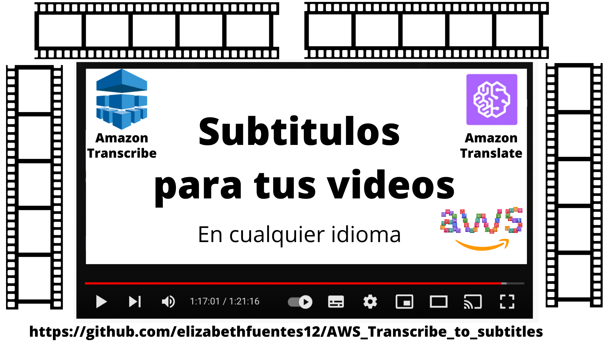
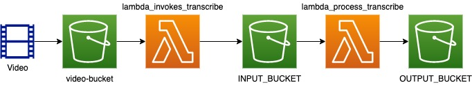

# Crea subtitulos en cualquier idioma para cualquier idioma con AWS.

Los videos no deben tener un tamaño mayor a 2048.00 Mb.
Formato: MP4

## Introducción

## Arquitectura 🤔 ⚙️

Revisando arquitecturas me encontré con

---

## Actualización (noviembre 2026)

- Runtime de las Lambdas: `python3.8` (deprecado el 14-10-2024) → `python3.13`.
- `aws-cdk-lib` 2.15.0 → 2.277.0.
- Verificado con `cdk synth` e importando los handlers con Python 3.13. Fechas de deprecación de runtimes: [Lambda runtimes](https://docs.aws.amazon.com/lambda/latest/dg/lambda-runtimes.html?trk=87c4c426-cddf-4799-a299-273337552ad8&sc_channel=el).
